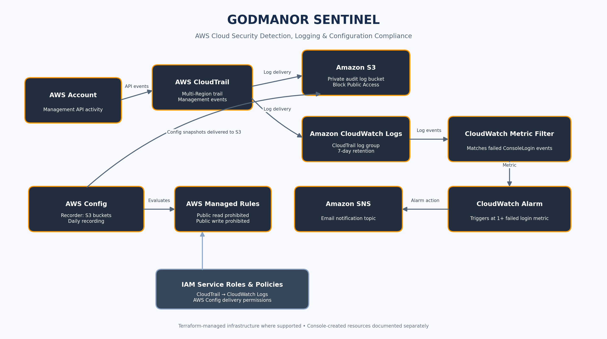

# GODMANOR SENTINEL

### AWS Cloud Security Detection, Logging & Configuration Compliance

**Monitoring. Detecting. Protecting.**

GODMANOR SENTINEL is an AWS cloud security monitoring and compliance project designed to demonstrate how cloud environments can be monitored, audited and protected using native AWS security services.

The project implements centralized audit logging, failed console login detection, automated email notifications and S3 security compliance monitoring.

---

## 1. Project Objectives

The objectives of GODMANOR SENTINEL are to:

- Monitor AWS account management activity.
- Collect and securely store audit logs.
- Detect failed AWS Console login attempts.
- Generate CloudWatch alarms for suspicious login activity.
- Send security notifications through Amazon SNS.
- Evaluate S3 bucket security configurations using AWS Config.
- Manage infrastructure using Terraform where supported.

## 2. AWS Architecture

### Architecture Flow

1. AWS CloudTrail records management events across the AWS account.
2. CloudTrail delivers audit logs to a private Amazon S3 bucket and Amazon CloudWatch Logs.
3. A CloudWatch metric filter identifies failed ConsoleLogin events.
4. A CloudWatch alarm monitors the failed login metric.
5. Amazon SNS delivers email notifications when messages are published to the configured topic and when the alarm triggers its configured action.
6. AWS Config records selected S3 bucket resources and evaluates them against security rules.

## 3. AWS Services Used

| AWS Service | Purpose |
|---|---|
| Amazon S3 | Private storage for audit logs |
| AWS CloudTrail | AWS management event auditing |
| Amazon CloudWatch Logs | Centralized log collection |
| CloudWatch Metric Filters | Failed login event detection |
| CloudWatch Alarms | Security alert monitoring |
| Amazon SNS | Email notifications |
| AWS Config | S3 security compliance evaluation |
| AWS IAM | Identity and access management |
| Terraform | Infrastructure as Code |

## 4. Security Controls Implemented

- S3 Block Public Access enabled.
- Multi-Region CloudTrail enabled.
- CloudTrail log file validation enabled.
- Management events configured for auditing.
- CloudWatch Logs retention configured to 7 days.
- Dedicated IAM user for Terraform lab operations.
- IAM permissions configured for required lab services.
- AWS Config recording restricted to selected resource types.
- S3 public-read and public-write managed rules configured.

## 5. AWS Config Compliance Rules

The project uses two AWS managed rules:

**Rule 1:** `s3-bucket-public-read-prohibited`

Checks whether S3 buckets allow public read access.

**Rule 2:** `s3-bucket-public-write-prohibited`

Checks whether S3 buckets allow public write access.

Both rules were created successfully. Compliance evaluation results were pending at the time of documentation.

## 6. Notification Testing

An SNS test message was successfully published to the configured security alert topic.

The subscribed email address received the notification.

The CloudWatch alarm was configured with the SNS topic as its alarm action. Direct SNS delivery was tested separately; an end-to-end failed-login alarm trigger has not yet been verified.

## 7. Infrastructure as Code

Terraform was used to manage selected AWS resources and configurations.

Project configuration includes:

- `main.tf`
- `monitoring.tf`
- `cloudtrail-logging.tf`

Some existing resources, including the SNS topic and initial AWS Config setup, were created through the AWS Management Console.

## 8. Limitations and Future Improvements

- Complete AWS Config compliance evaluation and capture results.
- Verify an end-to-end failed ConsoleLogin alarm notification.
- Improve IAM permissions through more restrictive resource-level policies.
- Expand the Terraform configuration to manage additional resources.

## 9. Learning Outcomes

This project provided practical experience with:

- AWS cloud security monitoring.
- CloudTrail audit logging.
- IAM permissions and least privilege.
- S3 bucket security.
- CloudWatch metrics, filters and alarms.
- SNS email notifications.
- AWS Config compliance monitoring.
- Terraform infrastructure management.
- Cloud security troubleshooting.

## 10. Project Information

**Project:** GODMANOR SENTINEL

**Category:** AWS Cloud Security

**Region:** `us-east-1`

**Infrastructure:** Terraform and AWS Management Console

---

